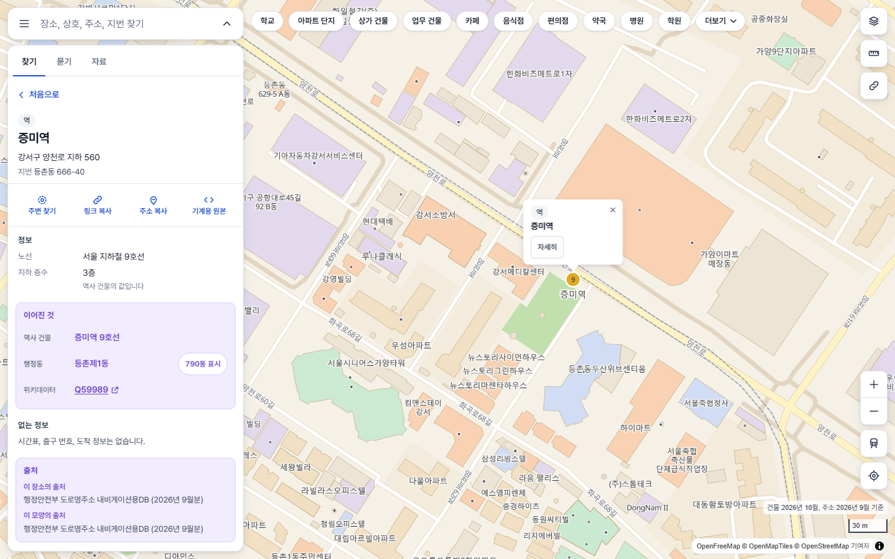
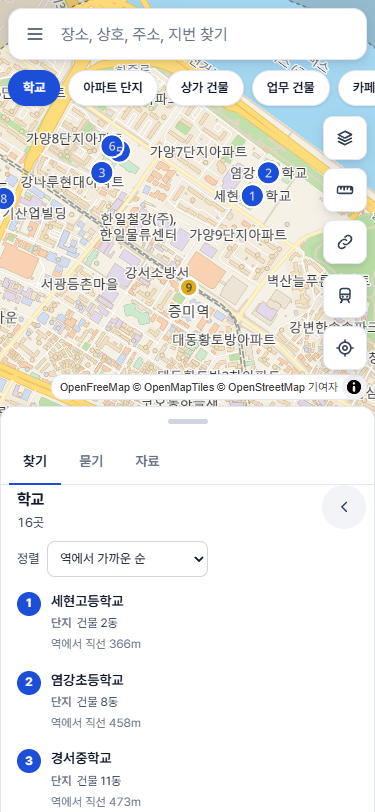
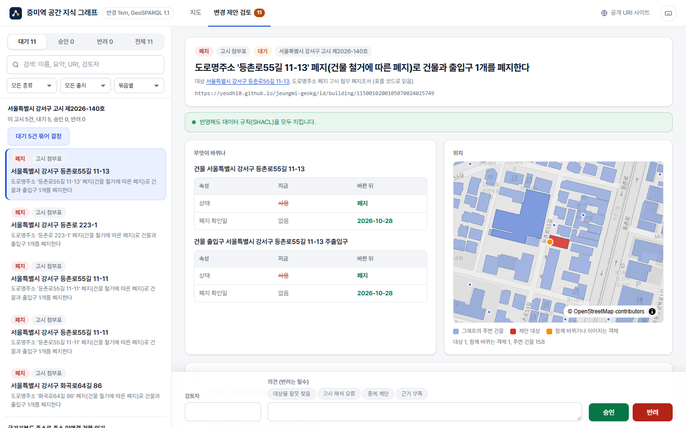
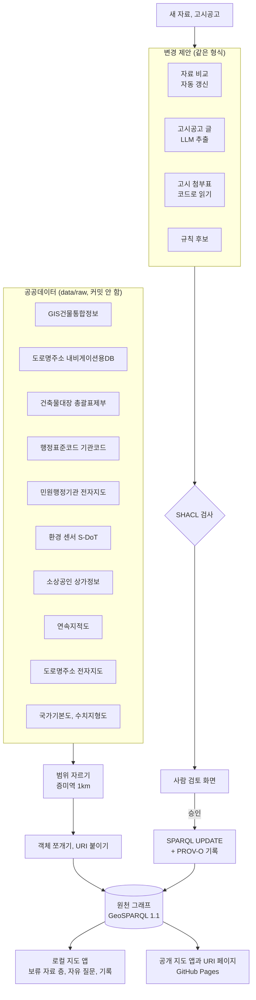

# 증미역 공간 지식 그래프 (Jeungmi GeoKG)

서울 지하철 9호선 증미역 반경 1km 안의 건물, 출입구, 필지, 도로, 공공시설, 역, 행정동과 법정동, 환경 센서, 상호(가게)를 "의미 있는 객체"로 쪼개고, 객체마다 공공기관이 매긴 관리번호를 그대로 써서 바뀌지 않는 주소(URI)를 붙인 뒤 GeoSPARQL 1.1 지식 그래프로 엮은 프로토타입입니다.

국토교통부의 "국가기본도 대전환" 방향인 **객체 원자화, 영구 식별자, 자동 갱신, AI 제안 후 사람 승인**을 작은 지역에서 실제 공공데이터로 처음부터 끝까지 돌려 보는 것이 목표입니다.

**URI가 실제로 열립니다:** https://yeodh10.github.io/jeungmi-geokg/ (예: [증미역](https://yeodh10.github.io/jeungmi-geokg/id/station/1150010200106660040000001), [어휘](https://yeodh10.github.io/jeungmi-geokg/def/)). 객체마다 사람이 읽는 페이지와 Turtle(`index.ttl`)이 있습니다.

**지도 앱도 바로 열립니다:** https://yeodh10.github.io/jeungmi-geokg/ 이 지도 앱입니다(옛 주소 `/map/`도 같은 앱을 엽니다). 장소, 주소, 지번, 상호, 공식 번호로 찾고, 누르면 카드에서 층수, 용도, 지은 때와 함께 공식 번호, 출처, 이어진 것을 봅니다. 휴대폰에서도 됩니다. '5분 둘러보기'가 고유 주소, 출처, 이어진 것, 질문, 기계용 원본을 차례로 보여 줍니다. 소개와 그래프 쓰는 법은 [/about/](https://yeodh10.github.io/jeungmi-geokg/about/)에 있습니다.

로컬 서버를 켜면 http://localhost:8000/map 에서 같은 앱에 공개하지 않는 자료 층(공공시설, 도로 구간, 법정동 경계, 국가기본도, 수치지형도), 자유 질문, 기록 탭이 더해집니다([실행](#실행)). 이 화면에는 공개하지 않는 자료가 보이므로 캡처를 바깥에 올리지 않습니다.

| 공개 지도 앱 (PC) | 공개 지도 앱 (휴대폰) |
|---|---|
|  |  |

| 변경 제안 검토 화면 (로컬 서버) |
|---|
|  |

지도 앱 캡처 두 장은 공개 사이트 화면으로만 찍었습니다. 검토 화면 캡처는 공개 자료(GIS건물통합정보, 도로명주소 출입구)만 보이는 제안으로 2026-10-30에 찍은 것입니다. 지금 검토 화면은 배경을 저장소에 구운 타일로 그려서 배경 모양이 조금 다릅니다.

## 이 프로젝트로 보여 드리려는 것

공간정보 시맨틱 모델링 업무를 네 가지로 나누고, 각각을 이 저장소의 어디에서 확인할 수 있는지 짝지었습니다.

| 하는 일 | 이 저장소에서 | 바로 보기 |
|---|---|---|
| 여러 공간 자료를 하나의 구조로 설계하고 거버넌스를 세우기 | 12종 공공 자료를 자료 목록(DCAT)으로 묶고, 자료마다 이용 조건과 공개 등급을 적어 SHACL로 강제합니다. 출처, 변경 이력, 공개 경계, 개인정보 규칙은 문서와 검사 코드에 함께 둡니다. | [docs/governance.md](docs/governance.md), [docs/survey-data.md](docs/survey-data.md) |
| 객체 사이 관계를 정의해 지식 그래프 스키마 만들기 | 건물, 출입구, 필지, 도로, 행정구역, 센서, 상호를 GeoSPARQL 객체로 쪼개고 관계(필지 위에 있다, 같은 건물이다, 면한 도로 구간 등)로 잇습니다. 국가기본도 지형지물 분류는 SKOS로 넣었습니다. | [어휘 페이지](https://yeodh10.github.io/jeungmi-geokg/def/), `src/graph/ontology.ttl` |
| AI와 LLM으로 비정형 공간 자료를 구조화하기 | 구청 고시공고 글에서 바뀌는 건물과 필지를 LLM으로 뽑아 변경 제안으로 만들고, 자연어 질문을 GeoSPARQL로 바꿉니다. 키가 없는 공개 사이트의 묻기 탭은 모델 없이 사람이 쓴 질문 틀로 답하고, 틀에 없는 한 장소의 질문은 그 장소의 카드 자료에서 근거를 찾아 답합니다(API 없는 검색 증강). 모델이 지어낸 값이 그래프에 들어가지 않도록 입력 가드와 원문 대조 단계를 둡니다. | `src/llm/`, [docs/llm-eval.md](docs/llm-eval.md) |
| AI 에이전트로 시맨틱 상호운용성을 검증하는 프로토타입 만들기 | Claude Code와 함께 만들었습니다. schema.org, INSPIRE, 위키데이터, BOT 어휘와 잇고, 외부 주소가 실제로 열리는지와 형식을 바꿔도 트리플이 그대로인지를 자동으로 검사합니다. | `src/graph/interop.py`, [docs/interop.md](docs/interop.md) |

지도의 '입체 보기'는 건축물대장의 높이 값으로 건물을 세운 LoD1 모형입니다. 오른쪽 아래 3D 버튼으로 켜고, 마우스로 돌리고 기울이거나 Q와 E 키로 돌리고 R과 F 키로 기울이며, '한 바퀴 돌아보기'로 천천히 돌려 볼 수 있습니다. W, A, S, D와 방향키로 옮기고(두 키를 같이 누르면 대각선, Shift를 누르면 빨리) +와 -로 확대합니다. 지도의 빈 땅을 누르면 Esc처럼 말풍선과 고른 장소를 닫고, 그 자리의 정보는 우클릭이나 길게 누르기로 봅니다. 거리는 어느 한 역에서 미리 재지 않습니다. 카드나 지도 말풍선에서 '거리 기준'으로 고른 곳에서 재고, 목록의 '가까운 순'과 주변 찾기, 조건 찾기도 그곳을 기준으로 합니다.

## 국가기본도 대전환 방향과 이 프로젝트

| 방향 | 이 프로젝트에서 한 것 | 어디에 |
|---|---|---|
| 객체 원자화 | 원천 공공데이터(아래 데이터 표)를 건물, 출입구, 필지, 도로와 도로 구간, 공공시설, 역, 행정동, 법정동, 기초구역 객체로 쪼갰습니다. 출입구는 면한 도로 구간에 이었습니다. 국가기본도 지형지물 분류(수치지도 작성 작업규칙 제9조)를 어휘에 넣고, 국가기본도 건물을 객체ID 그대로 받아 우리 건물과 이었습니다. 모든 객체는 GeoSPARQL Feature이고 모양(Geometry)은 따로 둡니다. 쪼개는 원칙과 파이프라인 단계는 원자화 규칙에 적었습니다. | [docs/uri-policy.md](docs/uri-policy.md), `src/model/`, `src/graph/ontology.ttl` |
| 영구 식별자 | 새 번호를 만들지 않고 건물관리번호, PNU, 도로명코드, 도로구간 일련번호, 법정동코드, 행정동코드, 기초구역번호, 행정표준코드 기관코드를 그대로 URI에 씁니다. 객체가 사라져도 URI는 남기고 상태만 폐지로 바꿉니다. 공개 자료로 만든 URI 페이지를 GitHub Pages에 올려 실제로 열리게 했습니다(배포된 판 약 2만 쪽, 다음 배포 21,872쪽). | [docs/uri-policy.md](docs/uri-policy.md), `src/graph/publish.py` |
| 자동 갱신 | 새 자료가 들어오면 그래프를 덮어쓰지 않고 객체마다 비교해 신규, 변경, 폐지, 주소 연결 제안을 만듭니다. | `src/review/diff_proposals.py` |
| AI 제안 후 사람 승인 | 고시공고 글에서 바뀌는 내용을 뽑는 일만 LLM이 하고, 대상 객체는 코드 규칙으로 찾습니다. 국가기본도 건물의 주소를 이용해 주소 미연결 건물을 건물관리번호가 있는 건물에 잇는 제안과, 점만 있는 건물에 국가기본도 모양을 붙이는 제안도 규칙으로 만듭니다. 모든 제안은 SHACL 검사를 거쳐 승인을 받아야 그래프에 들어가고, 누가 언제 승인했는지는 PROV-O로 남습니다. 국가기본도 규칙 제안 249건은 사람이 Claude에게 검토를 맡겼고, Claude가 데이터에서 잰 기준으로 결정했습니다. 기록의 검토자 이름에도 그대로 남아 있습니다. 다만 컴퓨터를 옮기면서 반려 110건의 기록을 잃었습니다(아래 '한계와 증거 수준' 참고). | `src/llm/`, `src/review/`, `src/graph/shapes.ttl` |

## 한계와 증거 수준

위 표는 '무엇을 만들었나'이고, 아래는 '얼마나 증명했나'입니다. 부족한 것을 먼저 적습니다.

| 주장 | 지금 증거 | 아직 없는 것 |
|---|---|---|
| 사람 승인 | 승인, 반려, 정정 흐름과 PROV-O 기록, SHACL 위반 시 승인을 막는 동작은 화면과 테스트로 확인했습니다. | 기록에 남은 결정은 모두 사용자가 위임한 검토자 `Claude (사용자 위임)`가 내렸습니다. 사람이 직접 다시 검토한 표본도, 그 일치율도 없습니다. 검토자 이름은 로그인 없이 직접 입력하는 값입니다. |
| 자동 갱신 | 같은 9월분 원본으로 범위 자르기 규칙만 바꿔 한 번 돌렸고(경계 건물 36동 생성, 34동 잇기), 승인 뒤 다시 비교하면 제안은 0건입니다. 승인으로 만든 객체도 다음 갱신 때 변경, 폐지 대상이 되게 했습니다. | 새 기준일 자료로 돌린 적이 없습니다(2026-11-03 현재 내비게이션용DB 10월분이 아직 나오지 않음). 실제 제안 수와 오탐률, 그리고 GIS 번호(A1)가 판이 바뀌어도 유지되는지는 아직 모릅니다. |
| AI 제안 | 실제 강서구 고시 95건으로 LLM의 변경 내용 추출을 평가했습니다([docs/llm-eval.md](docs/llm-eval.md)). | LLM이 뽑은 제안이 승인까지 간 기록은 0건입니다. 기록에 있는 고시 제안 5건은 첨부 표를 코드로 읽어 만든 것이고, 아직 대기 중입니다. 평가는 프롬프트를 고치기 전에 잰 것입니다. |
| 짝맞추기 (국가기본도, 전자지도) | 겹침(IoU), 넓이, 층수, PNU, 주소를 기준으로 잇고, 기준값은 이미 이은 쌍의 분포를 보고 정했습니다. | 사람이 정답을 표시한 표본으로 잰 정밀도와 재현율은 없습니다. |
| 승인 기록 | 정정할 때 기존 기록을 지우지 않고 새 사건으로 쌓습니다. | 2026-11-03 다른 컴퓨터로 옮기면서 기록을 규칙으로 다시 쌓았습니다. 국가기본도 승인 139건은 원래 시각으로 되살렸지만 반려 110건의 기록은 잃었습니다([docs/decisions.md](docs/decisions.md)). |
| 규모 | 반경 1km 범위는 처음부터 끝까지 돌렸습니다. | 서울, 전국 수치는 추정입니다([docs/scale-design.md](docs/scale-design.md)의 측정 한계 참고). |
| 법과 이용 조건 | 국가기본도와 수치지형도는 기본측량성과라 공개 사이트에서 뺐습니다. | 그 값을 해외 서버에서 도는 LLM 검토자에게 보여 준 것이 국외 반출에 해당하는지는 국토지리정보원에 질의해 확인해야 합니다. 연속지적도는 측량에 쓸 수 없는 참조용 도면입니다. |

## 표준과 상호운용성

우리 어휘(jgk)를 모르는 시스템도 이 그래프를 읽을 수 있도록, 외부 표준 위에 세우거나 외부 표준과 이었습니다. 외부 주소는 실제로 열리는지(없는 이름이면 404를 주는지) 확인한 것만 씁니다.

| 표준 | 쓰임 | 어디에 |
|---|---|---|
| GeoSPARQL 1.1 (OGC) | 모든 공간 객체와 모양, 위상 함수 | `src/graph/ontology.ttl` |
| SOSA/SSN (W3C, OGC) | 환경 센서와 1시간 관측값 | `src/model/build_sensors.py` |
| QUDT 단위 | 관측값 단위 (℃, %, dB, lux) | 어휘의 관측 항목 |
| PROV-O, SHACL, SKOS | 승인 기록, 데이터 규칙, 국가기본도 지형지물 분류 | `src/review/`, `shapes.ttl` |
| schema.org, INSPIRE 지형지물 개념, 위키데이터 | 외부 어휘의 이름으로 읽기 (증미역은 위키데이터 Q59989와 같은 실물) | [docs/interop.md](docs/interop.md), `src/graph/alignment.ttl` |
| BOT (W3C Linked Building Data) | BIM 모델 건물과 잇기 | [docs/bim.md](docs/bim.md) |

상호운용성 검사(`python -m src.graph.interop`)는 외부 주소 17개가 모두 열리는지, RDFS 추론 뒤 schema.org 이름만으로 역과 주소, 식별자를 찾을 수 있는지, JSON-LD와 N-Triples로 바꿔도 32만여 트리플이 하나도 바뀌지 않는지 확인하고, 증미역 좌표가 위키데이터 좌표와 얼마나 떨어져 있는지(44.8m) 잽니다.

## 시점별 판

승인으로 실제로 바뀐 트리플은 하나하나 RDF 진술(`jgk:hasChange`)로 함께 남깁니다. 정정으로 승인을 철회한 일도 사건으로 남습니다. 그래서 판마다 그래프를 통째로 복사하지 않아도 특정 시각의 값이나 두 시각 사이의 변경을 SPARQL로 조회할 수 있습니다(쿼리 15, 16, `src/graph/editions.py`). 시각 T의 값은 트리플마다 T 이전의 마지막 사건으로 정하며, 쿼리는 객체와 모양 노드마다 한 번씩 돌립니다. 로컬 지도의 기록 탭에서 '승인 바로 전 값과 견주기'를 누르면 그 시점의 값을 되살려 지금 값과 나란히 보여 줍니다. 되살린 값이 승인 전 원천 그래프와 똑같은지는 테스트로 확인합니다.

실제 사례: 강서구 **도로명주소 폐지 고시**(제2026-140호, 2026-10-28)의 첨부 폐지조서 12줄 가운데 범위 안에 있는 4곳을 그래프의 건물 5개와 맞춰, 건물과 출입구를 폐지하는 제안 5건을 만들었습니다(위 검토 화면). 이 5건은 아직 대기 중입니다.

## 숫자로 보기 (2026-11-03)

| 항목 | 값 |
|---|---|
| 건물 | 원천 2,790 (건물관리번호로 식별 2,162, 주소 미연결 628). 승인한 제안을 반영하면 2,826 (범위 경계 건물 36동을 새로 만듦), 주소 미연결 546, 모양 없이 점만 있는 건물 324 → 227. 층수 값이 없는 건물 467 |
| 건물 출입구 | 2,180 (주출입구 2,161, 보조출입구 19), 승인 반영 2,216 |
| 필지 | 1,760 (PNU, 92곳에 단지 정보, 1,718곳에 연속지적도 경계와 지목) |
| 공공시설 | 23 (행정표준코드 기관코드. 반경 안 26곳 중 규칙으로 맞춘 23곳. 우편취급국 2곳과 고용복지플러스센터 1곳은 기관코드를 붙이지 못해 검토 목록에 남김) |
| 도로 | 도로 76, 도로 구간 233 (출입구 2,120개가 면한 구간에 이어짐) |
| 행정동, 법정동, 기초구역, 역 | 8, 6, 54, 1 |
| 상호 | 3,332곳 (소상공인 상가정보 2026년 9월분, 상가업소번호로 식별. 건물에 3,322곳, 필지에만 10곳. 주택 건물 안 업체 가운데 407곳은 개인 집 주소일 수 있어 공개하지 않음) |
| 환경 센서 (S-DoT) | 5대, 그중 4대에 2026-10-12~18 1시간 평균 관측 2,428개 (기온, 습도, 소음, 조도, 자외선) |
| 국가기본도와 연결 | 국가기본도 건물 4,184(반경 1.25km 영역) 중 1,834동을 우리 건물 1,859동과, 수치지형도 건물 4,329(도엽 37608075, 37608085) 중 1,820동을 우리 건물 1,845동과 이음. 한 폴리곤을 함께 쓰는 건물은 모두 이어짐 |
| 트리플 | 원천 323,387 (상호, 필지 경계, 건물 높이, 자료 목록 포함), 어휘와 외부 어휘 정렬까지 넣고 승인 283건을 모두 얹으면 354,931 (충돌 0, 2026-11-04) |
| SHACL 검사 | 원천 자료 문제 1건만 남음 (대지면적 0인 필지) |
| URI 페이지 | 21,872쪽과 지도 앱 (2026-11-03 로컬 빌드, 공개 사이트에는 아직 올리지 않음. 공개 상호 2,925곳, 필지 1,760쪽(경계 1,718), 제안 7쪽 포함. 공개하지 않기로 한 공공시설, 도로 구간, 국가기본도와 수치지형도 건물, 주택 건물 안 일부 상호 등 9,191개는 뺌. 승인 가운데 근거가 모두 공개 자료인 자리표시 잇기 7건만 반영함) |
| 전체 다시 만들기 | `python -m src.pipeline` 한 번, 12~22분 (2026-11-03~04 측정, 다른 작업이 함께 돌던 컴퓨터) |
| LLM 평가 (실제 모델, 2026-11-05) | 자연어 질의 25문제 중 엄격한 기준 21문제 정답, 결과에 정답이 들어 있는 것까지 24문제. 실제 강서구 고시 96건 추출에서 근거 문장과 주소를 지어낸 것 0건. [docs/llm-eval.md](docs/llm-eval.md) |
| 테스트 | 파이썬 23종과 브라우저 코드 4종(찾기 1순위, 키 없는 질문, 그래프에서 찾아 답하기, 묻기 탭 대량 시험) (측량 성과 계보, 주소 잇기 규칙, 상호, 검토, 자동 갱신, 고시공고 LLM, 자연어 질의, SHACL, 폐지조서, 화면 API, 국가기본도 주소 연결, 평가 채점, 센서와 관측, 상호운용성, 시점별 판, BIM 연결, 입력 가드, 객체와 어휘, 공개 사이트 만들기, 공개 뷰, 공개 출력, 장소 목록, 카드) |

## 구조



- 원천 그래프는 원본에서 언제든 다시 만들 수 있게 두고, 승인된 변경만 그 위에 승인 순서대로 얹습니다. 지금까지의 결정은 사용자가 위임한 검토자 Claude가 내렸습니다(기록의 검토자 이름에 남아 있습니다).
- 새 자료로 원천 그래프를 다시 만들면 승인 당시의 값이 사라졌을 수 있습니다. 빼려는 값이나 바꿀 객체가 없으면 그 제안은 적용하지 않고 충돌로 남겨 `/api/status`와 검토 화면에 보여 줍니다.
- 공간 관계(맞닿음, 포함, 겹침)는 미리 계산해 두지 않고, SPARQL 안에서 `geof:sfTouches`, `geof:sfIntersects` 같은 GeoSPARQL 위상 함수로 계산합니다.
- LLM은 바뀌는 내용을 뽑거나 질문을 SPARQL로 바꾸는 데만 쓰고, URI를 정하는 일은 맡기지 않습니다. 모델이 영구 식별자를 지어내지 못하게 하려는 것입니다.

## 데이터

| 자료 | 제공 | 이용 조건 | 쓰임 |
|---|---|---|---|
| GIS건물통합정보 (서울) | 국토교통부, 브이월드 | 이용허락범위 제한 없음 | 건물 모양, 대장 속성, PNU |
| 도로명주소 내비게이션용DB | 행정안전부 | 이용허락범위 제한 없음 | 건물관리번호, 출입구, 행정동, 역 |
| 건축물대장 총괄표제부 | 서울열린데이터광장 | 공공누리 1유형 | 필지의 단지 정보 |
| 행정표준코드 기관코드 | 행정안전부 | 이용허락범위 제한 없음 | 공공시설 URI |
| 민원행정기관 전자지도 | 행정안전부 | 공공누리 1유형, 이용목적 심사 뒤 제공 (공개 페이지에서 뺌) | 공공시설 위치 |
| 도로명주소 전자지도 (서울) | 행정안전부 | 공공누리 1유형, 이용목적 심사 뒤 제공 (도로 구간과 경계 모양은 공개 페이지에서 뺌) | 도로 구간, 법정동과 기초구역 경계 |
| 국가기본도, 수치지형도 Ver2.0 | 국토지리정보원 | 공공누리 1유형이지만 기본측량성과라 공간정보관리법 제16조의 국외 반출 금지 대상 (공개 페이지가 해외 서버에 있어 뺌) | 국가기본도 건물과 우리 건물 잇기, 층수와 주소 비교 |
| 강서구청 고시공고 | 강서구청 | 저작권법 제7조 (고시, 공고) | 변경 제안의 근거 |
| 도시데이터 센서(S-DoT) 환경정보 | 서울열린데이터광장 | 공공누리 1유형 | 센서 위치와 1시간 관측값 |
| 연속지적도형정보 (서울) | 국토교통부, 브이월드 | CC BY | 필지 경계와 지목 |
| 상가(상권)정보 (서울) | 소상공인시장진흥공단, 공공데이터포털 | 이용허락범위 제한 없음 (주택 건물 안 일부 업체는 개인정보 보호를 위해 공개 페이지에서 뺌) | 상호와 업종, 들어 있는 건물 |

서울이나 전국으로 넓힐 때의 설계와 근거(저장소 크기, 질의 시간 측정)는 [docs/scale-design.md](docs/scale-design.md)에 있습니다.

원본은 저장소에 올리지 않습니다. 내려받는 방법, 좌표계 확인, 이용 조건의 근거는 [docs/data-sources.md](docs/data-sources.md)에 있습니다. 범위 중심은 내비게이션용DB의 증미역 역사 건물 중심점(경도 126.861247, 위도 37.557719)이고, 출처는 [config/area.yaml](config/area.yaml)에 적었습니다.

## 실행

명령은 프로젝트 폴더에서 Git Bash로 실행하는 것을 기준으로 적었습니다. Windows PowerShell에서는 `.venv/Scripts/python`을 `.\.venv\Scripts\python.exe`로 바꿔 씁니다.

```bash
python -m venv .venv
.venv/Scripts/python -m pip install -r requirements.txt
cp .env.example .env                                   # ANTHROPIC_API_KEY 등 키 값
```

원본 압축 파일을 `data/raw/_archives/`에 넣고 전체를 다시 만듭니다. 7-Zip이 없으면 먼저 `pip install py7zr`로 설치합니다.

```bash
.venv/Scripts/python -m src.pipeline --unpack
```

범위 자르기, 객체와 URI, 그래프, 예시 쿼리 결과(`data/processed/query_check.md`), SHACL 검사 결과(`validation_report.md`), URI 페이지(`site/`)가 차례로 만들어집니다.

화면 띄우기:

```bash
.venv/Scripts/python -m uvicorn src.review.app:app --host 127.0.0.1 --port 8000
```

http://localhost:8000 에서 변경 제안을 검토하고, http://localhost:8000/map 에서 지도 앱의 로컬 화면을 씁니다. 공개 사이트와 같은 앱(`web/app/`)이고, 자료만 이 서버의 API(`/api/places`, `/api/card` 등)에서 받습니다. 로컬에서만 더해지는 것은 `web/local/`에 있고, 공개 사이트에는 복사하지 않습니다.

- 왼쪽 아래 '로컬 서버, 보류 자료 층': 공공시설 23곳, 도로 구간, 법정동 경계, 국가기본도 건물, 수치지형도 건물을 켜고 끄며 범례를 봅니다. 공개 사이트에 없는 객체의 카드에는 공개 페이지 링크가 없습니다.
- 묻기 탭 위 '자유 질문': 보내기 전에 Claude API 키가 있는지 알려 주고, 키가 없으면 보내지 않습니다. 답에는 AI가 만든 쿼리라고 적습니다.
- 기록 탭: 승인된 변경, 고른 장소의 '승인 바로 전 값과 견주기', 날짜를 골라 시점 비교, 검토 화면으로 가기.
- 검토 화면의 '지도에서 보기'는 이 앱에서 그 장소를 엽니다.

키 없이 자유 질문 화면만 확인하려면 가짜 모델 서버를 씁니다. 모델 호출 함수만 가짜로 바꾸고, `.env`를 읽지 않으며, API 주소를 닿지 않는 곳(`http://127.0.0.1:9`)으로 둡니다. 승인 기록은 언제나 임시 복사본을 씁니다. 사본은 포트마다 한 자리에 두고 켤 때마다 덮어써서 쌓이지 않습니다(복사할 원본은 `--proposals`로 고릅니다).

```bash
.venv/Scripts/python -m tests.serve_fake_llm --port 8000
```

이 서버는 공개 보류 자료까지 그대로 읽는 로컬 전용 화면입니다. 그래서 127.0.0.1에만 띄우고, localhost, 127.0.0.1, [::1] 이외의 이름으로 들어온 요청은 받지 않습니다.

시점별 판과 상호운용성 검사:

```bash
.venv/Scripts/python -m src.graph.editions changes 2026-10-01 2026-11-01          # 두 시각 사이에 승인된 변경
.venv/Scripts/python -m src.graph.editions as-of <객체 URI> 2026-10-30T09:00       # 그 시각의 객체 값
.venv/Scripts/python -m src.graph.interop                                         # 외부 주소 확인까지 (인터넷 필요)
```

URI 페이지를 다시 올릴 때는 `gh-pages` 브랜치를 비운 뒤 `data/processed/site/`를 통째로 올립니다. 비우지 않으면 지운 페이지가 공개 사이트에 그대로 남습니다.

```bash
git worktree add ../jeungmi-geokg-pages gh-pages
find ../jeungmi-geokg-pages -mindepth 1 -maxdepth 1 ! -name .git -exec rm -rf {} +
cp -r data/processed/site/. ../jeungmi-geokg-pages/ && rm ../jeungmi-geokg-pages/publish_report.json
cd ../jeungmi-geokg-pages && git add -A && git commit -m "URI 공개 페이지 다시 만듦" && git push && cd -
git worktree remove ../jeungmi-geokg-pages
```

제안 만들기:

```bash
.venv/Scripts/python -m src.review.address_retirement data/raw/notices/attachments/20261028_폐지조서.xlsx --notice data/raw/notices/20261028_도로명주소_폐지_고시.txt
.venv/Scripts/python -m src.llm.notice data/raw/notices/<고시공고>.txt          # Claude API 키 필요
.venv/Scripts/python -m src.review.diff_proposals --raw <새 원본 폴더> --label 202610
.venv/Scripts/python -m src.review.make_proposals                               # 공공시설 기관코드 후보
.venv/Scripts/python -m src.review.basemap_proposals                            # 국가기본도로 주소 미연결 건물 잇기, 점만 있는 건물에 모양 붙이기
.venv/Scripts/python -m src.review.basemap_proposals --audit                    # 기존 승인 가운데 현재 규칙에서 벗어난 것 찾기 (승인 기록은 고치지 않음)
.venv/Scripts/python -m src.review.placeholder_proposals                        # 자리표시 모양뿐인 주소 미연결 건물을 같은 필지의 건물에 잇기
.venv/Scripts/python -m src.review.emap_proposals                              # 전자지도 건물 모양으로 주소 미연결 건물 잇기
.venv/Scripts/python -m src.review.same_building_migration                     # 옛 승인의 owl:sameAs를 jgk:sameBuildingAs로 옮기기
.venv/Scripts/python -m src.review.bim_proposals <BOT Turtle 파일>               # BIM 모델 건물 잇기 (docs/bim.md)
```

테스트(LLM 부분은 가짜 클라이언트로 돌아서 API 키가 없어도 됩니다. 제안 기록은 임시 복사본만 씁니다):

```bash
for t in test_address_link test_survey test_business test_review test_diff test_notice test_nl test_shacl test_address_retirement test_api test_basemap_link test_eval test_sensors test_interop test_editions test_bim_link test_guard test_objects test_publish test_public_view test_places test_cards test_public_output; do .venv/Scripts/python -m tests.$t; done
node tests/search_check.mjs
node tests/ask_check.mjs
node tests/rag_check.mjs
node tests/rag_sweep.mjs
```

공개 사이트를 다시 올리기 전에는 위 명령을 모두 돌립니다. `test_public_output`은 공개 파일에 들어가면 안 되는 이름이 있는지 찾고, `search_check`는 찾기 결과의 1순위를, `ask_check`는 키 없는 질문이 질문을 맞는 틀로 읽는지와 답하면 안 되는 질문에 답하지 않는지를, `rag_check`는 그래프에서 찾아 답하기가 맞는 장소와 근거로 답하는지를, `rag_sweep`은 종류 질문 1,920개, 장소 질문 822개, 건물 안 질문 80개, 순위 질문을 묻기 탭의 차례대로 돌려 답을 못 하거나, 공개 자료에 있는 곳을 없다고 하거나, 기준 장소를 잘못 읽거나, 순위 1위가 자료와 다른 것이 없는지를 확인합니다. 가상환경에 pytest를 따로 설치하지 않았기 때문에 테스트마다 모듈로 실행합니다.

## 주요 기능

### 변경 제안과 승인

- 제안은 출처(`rule-candidate`, `data-diff`, `llm-notice`, `notice-table`)와 상관없이 형식이 같고, 대상 URI, 근거, 넣고 뺄 트리플, 위치를 담습니다.
- 검토 화면은 바뀌는 내용을 객체별로 "현재 → 변경 후"로 보여 주고, 반영 결과를 SHACL로 미리 검사해 규칙을 어기면 승인을 막습니다.
- 승인하면 바뀐 객체가 `prov:wasInfluencedBy`로 제안을 가리키고, 제안에는 승인한 사람과 시각이 남습니다. 반려한 제안도 기록에 남습니다.
- 검토 화면: 같은 고시에서 나온 제안을 묶어 보여 줍니다(예: "서울특별시 강서구 고시 제2026-140호, 이 고시 5건"). 검색, 종류와 출처별 거르기, 정렬을 할 수 있고 결정 이력(누가, 언제, 사유)도 볼 수 있습니다. 반려할 때는 사유를 꼭 적어야 합니다. 단축키(j, k 이동, a 승인, r 반려, / 검색, ? 안내)로도 처리할 수 있습니다.
- 묶어 결정: 같은 고시에서 나온 대기 제안을 순서대로 검사합니다. 각 제안은 앞 제안을 반영한 그래프 위에서 SHACL로 검사합니다. 통과한 제안만 한 번에 승인하고, 규칙을 어긴 제안은 대기로 남깁니다. LLM이 뽑은 제안과 경고(flags)가 붙은 제안은 묶어 승인할 수 없어 하나씩 봐야 합니다. 이렇게 하면 같은 건물을 두 제안이 서로 다르게 바꾸는 경우처럼 하나씩 볼 때는 드러나지 않는 충돌을 잡을 수 있습니다.
- 결정 정정: 승인이나 반려가 틀렸으면 기록을 지우지 않고 정정합니다. 대기로 되돌리거나, 승인을 반려로, 반려를 승인으로 바꿀 수 있으며, 이때도 사유를 꼭 적어야 합니다. 앞의 결정은 정정 이력에 그대로 남습니다. 승인을 철회하면 그 일도 사건으로 남아 지난 이력이 지워지지 않습니다. 뒤에 승인된 제안이 같은 객체를 바꿨거나 가리키면 그 제안부터 정정하도록 막고, 철회한 뒤의 그래프가 규칙을 어기면 철회하지 않습니다.
- 서버를 켜면 그래프를 백그라운드에서 미리 불러 둡니다(`/api/status`로 확인). 자연어 질의의 SPARQL은 별도 프로세스에서 실행합니다. 시간이나 메모리 상한을 넘기면 504를 돌려주고, 그 프로세스를 끝낸 뒤 새로 띄웁니다. 새로 띄우는 동안 들어온 질의에는 503을 돌려줍니다.
- 503을 돌려주는 경우는 세 가지입니다. 질의 작업 프로세스를 새로 띄우는 중일 때, 다른 프로세스가 제안 파일을 잠근 채 기다려도 풀리지 않을 때(파일은 그대로 둠), 제안 파일에 읽을 수 있는 기록이 하나도 없을 때(깨진 파일로 보고 덮어쓰지 않은 채 멈춤)입니다.
- 지도 앱은 공개 사이트와 로컬 서버가 같은 코드를 씁니다. 찾기(장소, 주소, 지번, 상호, 공식 번호), 분류 칩, 결과 목록과 번호 표식, 장소 카드(공식 번호, 출처, 이어진 것, 없는 정보), 주변 찾기, 묻기, 자료 탭, 5분 둘러보기, 지도 보기(건물 종류, 층수, 지은 때, 행정동, 입체 보기)가 있습니다. 고른 장소와 배율이 주소창에 남아 그 주소를 그대로 공유할 수 있습니다.
- 로컬 지도는 여기에 도로 구간, 법정동 경계, 공공시설, 국가기본도와 수치지형도 건물 층, 자유 질문, 기록 탭을 더합니다. 카드의 '장소 페이지 열기'와 '기계용 원본'은 공개 사이트에 그 장소의 페이지가 있을 때만 보입니다.
- API는 URI 입력을 검사해 SPARQL 주입을 막습니다. 제안 파일을 쓸 때는 OS 파일 잠금을 걸어 여러 프로세스의 결정이 섞이지 않게 하고, 지도 레이어는 gzip과 ETag를 붙여 보냅니다. Host와 Origin 헤더를 확인하고, 요청 본문 크기, 질문 수, 무거운 검사의 동시 실행 수에 상한을 둡니다.

### 자동 갱신

| 제안 | 언제 | 승인하면 |
|---|---|---|
| create | 새 자료에만 있는 객체 | 객체와 모양을 추가 |
| update | 값이 달라진 객체 | 이전 값을 빼고 새 값을 넣음 |
| retire | 새 자료에서 사라진 객체 | 지우지 않고 상태를 폐지로, 폐지 확인일 기록 (URI 유지) |
| link | 주소 미연결 건물이 새 건물관리번호 건물의 모양으로 쓰임 | 상태를 주소 연결됨으로, `jgk:sameBuildingAs`로 새 URI와 연결 |

빼는 값은 두 자료를 비교해 얻은 값이 아니라, 승인까지 반영한 현재 그래프에서 뽑습니다. 승인된 값을 덮어쓰게 되면 경고(flags)를 남깁니다.

### 고시공고에서 제안 만들기

- 글로 된 본문에서는 LLM(`claude-opus-5-5`, 구조화 출력)이 변경 종류, 대상의 주소나 이름, 새 값, 원문 문장을 뽑습니다. 안전 분류기가 거절하면 서버가 다른 모델로 다시 돌립니다(`fallbacks: "default"`).
- 첨부가 표(엑셀)이면 LLM 없이 코드가 읽습니다.
- 대상 객체는 코드가 이름, 도로명주소, 지번 순서로 찾습니다. 정확히 하나로 좁혀진 것만 제안이 되고, 후보가 여럿이면 보고서에만 남깁니다.
- 모델의 출력은 코드가 다시 확인합니다. 근거 문장, 대상 주소와 이름, 새 값이 원문에 있어야 제안이 되며, 고시 묶음과 고시 객체는 모델 출력이 아니라 파일 머리에 적힌 시군구와 번호로 정합니다.

### 입력 가드

- 고시 본문과 자연어 질문은 LLM에 보내기 전에 입력 가드(`src/guard`)를 거칩니다. 판정이 차단이면 보내지 않고, 검토이면 제안에 경고를 남깁니다. 가드는 세 층으로 되어 있습니다.
  - 규칙 층: 숨은 문자, 유사 문자, 인코딩을 풀어 여러 사본(뷰)을 만든 뒤 정규식을 적용합니다. 표준 라이브러리만 쓰고, 어떤 입력이든 CPU 시간 2초 안에 끝나도록 제한했습니다.
  - LLM 층(고시만): 원문을 호출마다 바뀌는 난수 구분자로 감싼 뒤 작은 모델(`claude-haiku-5-5`)이 읽고, 돌려 말한 지시를 가려냅니다. 이 층이 판정을 내리지 못하면 통과시키지 않고 검토로 넘깁니다.
  - 출력 층: 모델이 뽑은 글에서 전화번호, 이메일, 비밀값을 가립니다.
- 규칙 층 측정 결과(이미 본 묶음이라 블라인드 평가는 아닙니다): 공격 92줄 중 차단 28, 검토 3. 일부러 만든 우회 89줄 중 차단 82, 검토 2. 실제 고시 97건(평가용 95건과 사례 고시 2건)과 질문 25개에서는 오탐이 0건입니다. LLM 층은 유료 호출이라 실제 모델로는 재지 않았습니다.
- 입력 가드로 모든 공격을 막지는 못합니다. 위조 사실, 업무 문체로 쓴 작성 지시, 바꿔 말하기, 권위 사칭은 행정 문서와 겉모양이 같아서 걸러 내지 못합니다. 그래서 뒤 단계를 허용 목록 방식으로 묶었습니다. 고시는 코드가 객체를 찾고, 근거 문장, 주소, 새 값, 효력 날짜를 원문과 대조합니다. 주소는 자료에 있는 낱말로만 풀고, 사람 승인을 거쳐야 그래프에 들어갑니다. 질의는 읽기 쿼리만 실행합니다.

### 키 없는 질문 (공개 사이트 묻기 탭)

- 공개 사이트에는 서버도 API 키도 없어서, 묻기 탭의 입력칸은 모델 없이 브라우저 안에서 답합니다. 질문 틀은 `config/questions.yaml`의 사람이 쓴 쿼리 17개이고, 틀마다 같은 뜻의 다른 말투(forms)를 적어 두었습니다.
- 틀에는 빈칸이 있습니다(거리, 지상 층수, 용도, 법정동, 길 이름, 업종, 이름 낱말, 사용승인 연도, 출입구 수, 세대수). 빈칸이 받을 수 있는 값은 그래프에서 세어 정하고(`src/graph/askforms.py`), 빌드 때 모든 조합(3,429가지)마다 그 쿼리를 공개 범위 그래프에서 실행해 `ask.json`에 담습니다.
- 브라우저(`web/app/ask-match.js`)는 입력에서 빈칸 값을 단위와 사전으로 찾고, 두 글자 조각 유사도로 가장 가까운 말투를 고른 뒤, 그 조합의 결과를 보여 줍니다. 여러 틀에 두루 나오는 조각('증미', '건물')은 가볍게 셉니다.
- 짐작하지 않습니다. 유사도가 낮으면 못 알아들었다고 하고 비슷한 질문을 보여 줍니다. 틀이 받지 않는 조건이나 반대 비교('10층 이하'), 미리 실행하지 않은 값('350m')이 있으면 답하지 않고 고를 수 있는 값을 알려 줍니다. '15층 넘는'처럼 정확히 바꿀 수 있는 말은 '16층 이상'으로 바꾸고, 그렇게 바꿨다고 답 아래에 적습니다.
- 답 아래 '어떻게 찾았나요'에 고른 틀, 가장 가까운 말투, 유사도, 빈칸 값, 실행한 쿼리를 보여 줍니다. 로컬 서버에서는 이 입력칸 대신 Claude 자유 질문을 씁니다.
- 틀은 증미역 둘레나 전체 건물을 묻는 것이라, '강서아이티밸리 몇 층이야', '올리브영 증미역점 주소', '증미역에서 가양역까지 거리', '가양역 500m 주변 카페'처럼 한 장소를 물으면 그래프에서 찾아 답합니다(`web/app/ask-rag.js`). 모델과 API 없이 하는 검색 증강 답하기입니다.
  - 찾기: 찾기 색인으로 질문 속 장소를 찾고(최대 둘, 초성과 한영 오타도 받음), 무엇을 묻는지(층수, 사용승인일, 용도, 주소, 지번, 공식 번호, 노선, 옆 역, 행정동, 우편구역, 길, 입구, 들어 있는 건물, 출처, 거리, 둘레의 업종)를 낱말 목록으로 정합니다.
  - 근거: 그 장소의 카드 자료(공개 범위 그래프에서 빌드 때 만든 `card.json`)에서 칸을 고릅니다. 역이나 상호의 카드에 없는 칸은 이어진 역사 건물이나 들어 있는 건물의 카드에서 찾고 그렇다고 적습니다. 거리는 두 곳의 좌표로 잰 직선 거리입니다.
  - 답: 사람이 쓴 문장 틀에 근거 값을 넣고, 근거 칸 목록과 '어떻게 찾았나요'를 함께 보여 줍니다. 값이 없으면 지어내지 않고 없다고 답하고, 영업시간이나 전화번호처럼 이 자료에 아예 없는 것은 없는 정보라고 답합니다. 장소를 찾지 못하면 답하지 않습니다.
  - 종류 묻기: '증미역에서 가장 가까운 닭한마리 집', '국밥집 어디 있어', '가양역 1km 이내 쌀국수'처럼 가게나 시설의 종류를 물으면, 찾기 색인 전체에서 상호 이름, 업종, 건물과 단지 이름, 바로가기 묶음으로 맞는 곳을 모두 모아 기준 장소에서 가까운 차례로 답합니다. 비슷한 말('맛집'은 음식점, '커피숍'은 카페)과 상표 철자('GS25'와 '지에스25', 'CU'와 '씨유')를 함께 찾습니다.
  - 건물 안과 둘레: '강서아이티밸리 안 카페', '강서아이티밸리에 뭐 있어'는 그 건물에 이어진 상호를 층과 함께 답합니다. 한 건물이 건물 정보와 주소 정보에 따로 잡힌 곳이 있어 같은 필지에 선 건물을 함께 봅니다. '등촌역 근처에 뭐 있어'는 반경 300m 안의 상호를 업종별로 셉니다.
  - 순위: '가장 높은 건물', '제일 오래된 건물', '세대수 가장 많은 아파트', '증미역 근처 가장 높은 건물'은 건물 행의 높이, 층수, 사용승인일, 세대수로 줄을 세워 답하고, 값이 있는 건물 몇 곳만 견줬는지 함께 적습니다. 같은 단지의 여러 동은 하나만 보여 줍니다.
  - 있는 곳을 없다고 하지 않습니다. 이름이나 업종에 그 말이 없는 음식은 이어 둔 업종('짜장면'은 중국집, '국밥'은 국/탕/찌개류)의 가게를 따로 보여 주되, 메뉴는 자료에 없어 그 음식을 파는지는 알 수 없다고 적습니다. 은행이나 관공서처럼 상가정보에 아예 없는 갈래는 없다고 하지 않고 이 자료로는 알 수 없다고 답합니다. 정말 없으면 무엇을 어디까지 찾아봤는지 밝히고, 글자가 비슷한 이름이 있으면 함께 알려 줍니다.
  - 장소와 묻는 것이 분명하면 틀보다 먼저 답합니다. 틀은 다른 장소의 층수나 주소를 물어도 증미역 틀에 걸릴 수 있고, 모르는 업종은 기본값('카페')으로 채우기 때문입니다. 그래서 다른 장소를 기준으로 묻거나, 틀의 빈칸 값에 물은 종류가 들어 있지 않으면 틀에 맡기지 않습니다. 길과 동네를 묻는 질문, 증미역 둘레에서 틀이 아는 업종은 틀이 표와 쿼리까지 보여 주므로 틀에 맡깁니다.

### 자연어 질의

- LLM이 어휘, 그래프의 주요 이름과 값, 예시 쿼리(`src/graph/queries/`)를 보고 SPARQL을 씁니다.
- 실행 전에 코드가 읽기 쿼리(SELECT, ASK)만 통과시키고, 결과는 500행으로 제한합니다. 실행에 실패하면 오류 메시지를 붙여 한 번 더 쓰게 합니다.
- pyoxigraph에는 거리 함수가 없습니다. 그래서 "역에서 300m 안" 같은 조건은 LLM이 `{{NEAR:<URI>:<미터>}}`로 쓰게 하고, 코드가 이를 원 모양(EPSG:5186에서 계산)으로 바꿉니다.

### 센서와 관측 (SOSA/SSN)

- 서울시 도시데이터 센서(S-DoT) 설치 위치정보에서 증미역 1km 안에 있는 5대를 골라(내려받은 주에 관측이 있는 것은 4대), 모델 시리얼을 그대로 써서 `sensor/{시리얼}` URI를 붙였습니다. 관측 URI는 `observation/{시리얼}-{측정 시각}-{항목}`입니다.
- 센서는 설치 주소와 도로명주소가 같은 건물에 `jgk:addressBuilding`으로 잇습니다. 다만 센서 위치가 그 건물에서 8.8~24.1m 떨어져 있어(가로등이나 전봇대에 단 것으로 보임) '건물에 달렸다'(`sosa:isHostedBy`)고는 쓰지 않았습니다.
- 공개 사이트의 센서 페이지는 항목별 개수, 평균, 범위와 시간별 꺾은선 차트를 보여 줍니다. 쿼리 14는 증미역 500m 안 센서의 평균 소음과 기온을 그래프에서 구하고, 그 값이 원본 CSV로 직접 계산한 값과 같은지 테스트로 확인합니다.

### BIM 연결

- BIM은 그래프에 합치지 않고, 같은 건물이라는 연결(`jgk:bimBuilding`)만 둡니다. 층, 공간, 부재는 IFC를 W3C BOT 어휘로 바꾼 BIM 그래프에 그대로 둡니다.
- 건물관리번호가 같으면 번호로 잇고, 번호가 없으면 위치 점을 품은 건물 모양이 하나뿐일 때만 위치로 잇습니다. 층수는 건축물대장과 비교해 근거에 적고, 검토자가 승인합니다.
- 범위 안 건물의 공개 IFC를 찾지 못해, 규칙은 테스트에서 만든 작은 BOT 그래프로만 확인했습니다([docs/bim.md](docs/bim.md)).

### 데이터 규칙 (SHACL)

`src/graph/shapes.ttl`에 적은 규칙은 상태 값, 출처, 기본 모양, 건물 식별 번호(건물관리번호 25자리와 GIS 번호 28자리 중 정확히 하나), PNU 형식, 기관코드 7자리, 폐지하면 폐지 확인일, 출입구는 건물과 이어질 것, 같은 건물 잇기의 대상(있는 건물, 자기 자신과 사슬 금지, 하나씩), 고시의 표제와 고시일은 하나씩, 관측은 센서, 항목, 값, 시각이 하나씩일 것 등입니다. WKT 값 검사, 종류와 모양 출처 빼기 금지처럼 SHACL로 적을 수 없는 규칙은 `src/graph/validate.py`에 있습니다. 첫 검사에서 필지 1,697개에 출처가 빠진 것을 찾아 고쳤습니다.

## 기술 스택

Python 3.12, geopandas, shapely, pyproj, pyogrio, rdflib, pyoxigraph (SPARQL, GeoSPARQL 위상 함수), pyshacl, owlrl (RDFS 추론), Claude API, FastAPI, MapLibre GL JS(저장소에 둠), OpenFreeMap 벡터 타일을 구워 저장소에 둔 배경지도(OpenStreetMap 자료). 저장 좌표계는 EPSG:4326, 거리 계산은 EPSG:5186입니다. 기본값을 바꾸거나 새로 정한 사항은 [docs/decisions.md](docs/decisions.md)에 날짜와 이유를 함께 적었습니다.

## 만든 방법

이 저장소는 AI 코딩 에이전트(Claude Code)와 함께 만들었습니다. 사람이 목표, 규칙, 자료와 이용 조건, 승인 여부를 정하고, 에이전트가 구현과 검증을 맡았습니다.

- **규칙을 먼저 정함**: 값과 좌표는 추측하지 않는다, 공식 번호를 URI에 그대로 쓴다, 원본과 키는 커밋하지 않는다, 이용 조건을 확인하지 못한 자료는 공개하지 않는다. 에이전트는 이 규칙 안에서 일했고, 규칙과 부딪히는 선택은 근거와 함께 [docs/decisions.md](docs/decisions.md)에 남겼습니다.
- **확인한 것만 씀**: 외부 어휘 주소는 실제로 열어 확인했고, 없는 이름에도 200을 돌려주는 주소(OGC CityGML 3.0)는 쓰지 않았습니다. 센서 평균, 위키데이터 좌표 같은 숫자는 원본으로 따로 계산한 값과 비교해 맞췄습니다.
- **여러 에이전트로 감사**: 화면과 API를 고칠 때는 감사, 구현, 검증 역할을 나눈 워크플로로 작업했습니다(커밋 790ce20).
- **테스트로 묶음**: 기능마다 흐름 테스트를 두었고, 실제 승인 기록을 건드리지 않도록 임시 복사본으로만 시험합니다.

## 폴더 구조

```
config/          대상 범위, 역, 공개 보류 출처
data/raw/        원본 데이터 (커밋 안 함)
data/processed/  잘라낸 자료, 객체, 그래프, 검사 결과, 제안 기록 (커밋 안 함)
src/ingest/      압축 풀기, 범위 자르기
src/model/       객체 쪼개기, URI
src/graph/       어휘, 그래프, 예시 쿼리, SHACL, URI 페이지
src/llm/         Claude API 호출, 고시공고 추출
src/review/      변경 제안, 자동 갱신 비교, 폐지조서, 검토 API
src/query/       자연어 질의
web/             검토 화면, 지도 앱(web/app, 공개와 로컬 공통), 로컬 전용 모듈(web/local), 공개 사이트의 모양과 스크립트
tests/           흐름 테스트
docs/            데이터 출처, URI 규칙, 결정 기록, 시연 순서, 규모 설계, LLM 평가, 상호운용성, BIM 연결
```

## 진행 상황과 남은 일

처음 세운 4주 계획(10/28 ~ 11/24)과 실제로 끝낸 날짜입니다. 계획보다 앞당겨 끝낸 단계가 많습니다.

| 단계 | 계획한 주 | 실제 |
|---|---|---|
| 데이터 받기, 범위 자르기, 이용 조건 기록 | 10/28 ~ 11/3 | 10/30 끝 |
| 객체 쪼개기, URI, 그래프, SPARQL | 11/4 ~ 11/10 | 10/29 끝 |
| LLM 변경 제안, 자연어 질의 | 11/11 ~ 11/17 | 10/30 끝 (실제 모델로 평가까지) |
| 검토 화면, 지도 화면, 배포, README | 11/18 ~ 11/24 | 11/3 끝 |
| 시연 영상 | 11/18 ~ 11/24 | 남음 |

할 일 목록:

- [x] 실제 Claude API 키로 고시공고(등촌1구역 관리처분계획 변경인가)와 자연어 질의 돌려 보기 (고시는 구체적 변경이 없어 제안 0건, 질의 3개 정답)
- [x] LLM 평가 세트: 자연어 질의 25문제(정답 SPARQL), 실제 강서구 고시 95건(정답 23건) ([docs/llm-eval.md](docs/llm-eval.md))
- [x] 고시의 변경 종류 넓히기: 구역 지정, 해제, 사업 인가, 준공을 더해 other 비율을 90%에서 2%로 낮춤. 고시를 객체(notice/{시군구코드}-{연도}-{번호})로 두고, 대상 필지와 건물에서 고시로 잇는 제안
- [x] GitHub Pages로 URI 페이지 배포 (10/29, `gh-pages` 브랜치, 공공시설 23곳은 공개 보류로 제외)
- [x] 도로명주소 전자지도로 도로 구간, 출입구의 `facesRoad`, 법정동과 기초구역 넣기 (행정동 경계는 전자지도에 없음. 주소 미연결 건물 628개는 PNU로 법정동에 이음)
- [x] 국가기본도 지형지물 분류(수치지도 작성 작업규칙 제9조)를 어휘에 넣고, 국가기본도와 수치지형도 건물을 공식 번호(nf_id, UFID)로 넣어 우리 건물과 잇기
- [x] 국가기본도 주소로 주소 미연결 건물 잇기 제안 (41건 중 39건 승인, 2건 반려)
- [x] 국가기본도를 반경 1km 전체로 받기 (10/30, 반경 1.25km 원. 이은 건물 109 → 1,834동, 주소 연결 제안 5 → 41건)
- [x] 수치지형도 37608085 도엽 받기 (10/30, 두 도엽이 반경 1km 원의 99.98%를 덮음. 이은 건물 1,685 → 1,820동)
- [x] 점만 있는 건물 324개에 국가기본도 건물 모양 붙이기 제안 (208건 중 100건 승인, 108건 반려. 반려 기준을 데이터로 정해 규칙에 다시 반영)
- [x] 규칙에서 벗어난 승인 13건 정정 (13건 철회, 자리표시 모양을 겹침 판단에서 빼도록 규칙을 고친 뒤 5건 다시 승인. 현재 규칙에서 벗어난 승인 0건)
- [x] 승인 기록의 `owl:sameAs` 34건을 `jgk:sameBuildingAs`로 옮기기 (`fix-same-building-*`, 건물끼리의 owl:sameAs 0건)
- [x] 0.08㎡ 자리표시 모양을 가진 주소 미연결 건물 13동 잇기 (7동 이음, 6동은 근거가 모자라 남겨 둠)
- [x] 전자지도 건물 폴리곤으로 주소 미연결 건물 잇기 (7동 이음. 나머지는 대부분 주소 없는 부속 구조물)
- [x] 범위 경계에 걸쳐 주소를 잃은 건물 36동을 자동 갱신으로 새로 만들고 34동 잇기 (주소 미연결 628 → 546)
- [x] 민원행정기관, 전자지도, 국토지리정보원 자료 이용 조건 조사 (공공데이터포털 등록 정보, 공간정보관리법 제16조)
- [x] 전자지도 2종은 공개 보류로 결정 (10/30)
- [ ] 국토지리정보원에 해외 서버 게시 질의 (선택)
- [ ] 새 기준일 자료로 자동 갱신 실제로 돌려 보기 (내비게이션용DB 10월분은 2026-11-03에 아직 없음. GIS건물통합정보 새 판도 후보)
- [x] 필지 경계(연속지적도) 붙이기 (브이월드 연속지적도형정보, CC BY. 1,760개 중 1,718개)
- [ ] 시연 영상 ([docs/demo.md](docs/demo.md) 순서대로)
- [x] 같은 고시 제안 묶어 승인 (SHACL 통과한 것만, 앞 제안을 반영한 상태로 다음 제안을 검사)
- [x] 결정 정정 기록 (반려 기록을 지우지 않는 설계에 맞춰 "정정"을 새 기록으로 남기기)
- [x] 서버 시작 때 그래프 미리 불러오기, 자연어 질의 쿼리 시간 제한
- [x] 공개 사이트에 전체 지도 (서버 없이 건물, 출입구, 센서, 역)
- [x] 공개 사이트를 지도 앱으로 (찾기, 칩, 카드, 주변 찾기, 묻기, 자료, 5분 둘러보기, 휴대폰 시트, 입체 보기)
- [x] 로컬 서버 지도도 같은 앱으로 (보류 자료 층, 자유 질문, 기록 탭). 옛 지도 화면 파일(`web/map.html`)은 지웠습니다
- [x] 환경 센서와 관측을 SOSA/SSN으로 (S-DoT 5대, 그중 4대의 관측 2,428개)
- [x] 외부 표준 어휘와 잇기, 상호운용성 검사 (schema.org, INSPIRE, 위키데이터, BOT)
- [x] 시점별 판: 지난 시점 값과 두 시각 사이 변경을 SPARQL로
- [x] BIM 연결 설계와 프로토타입 (실제 IFC로는 아직)
- [x] 상호를 그래프 객체로 (상가업소번호 URI, 건물관리번호와 PNU로 건물에 잇기, 주택 건물 안 업체 공개 규칙)

다른 컴퓨터에서 이어서 작업할 때는 `git clone`으로 받고 가상환경을 만든 뒤, 원본 파일(`data/raw/_archives/`, 12개, 약 1.2GB)와 고시공고 폴더(`data/raw/notices/`)를 같은 위치에 두고 `python -m src.pipeline --unpack`을 실행하면 됩니다.
