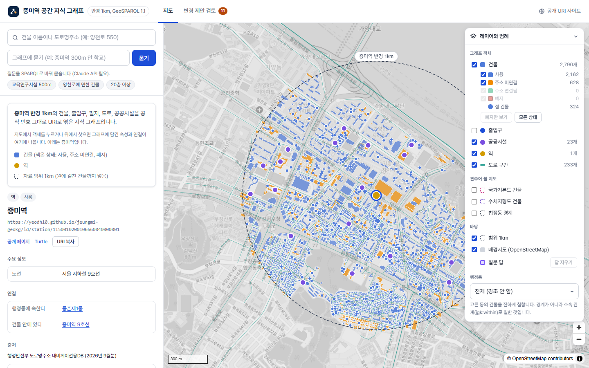
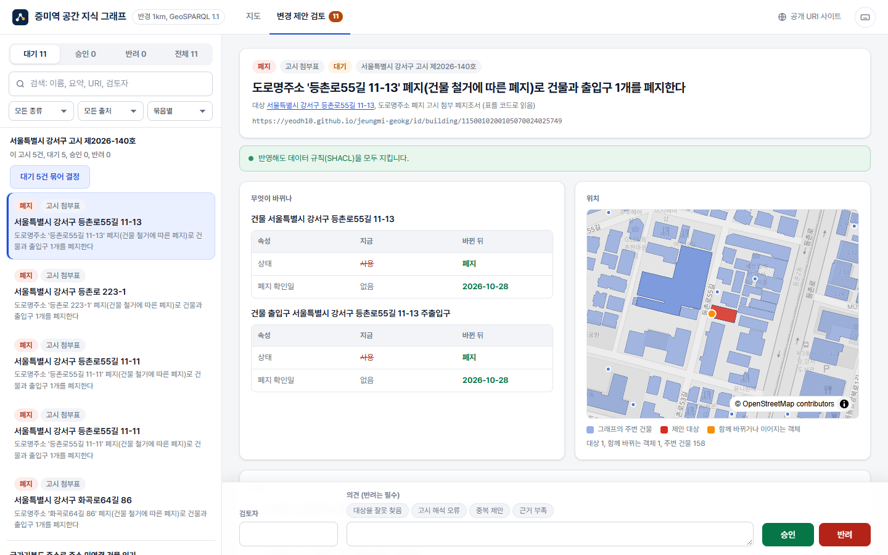
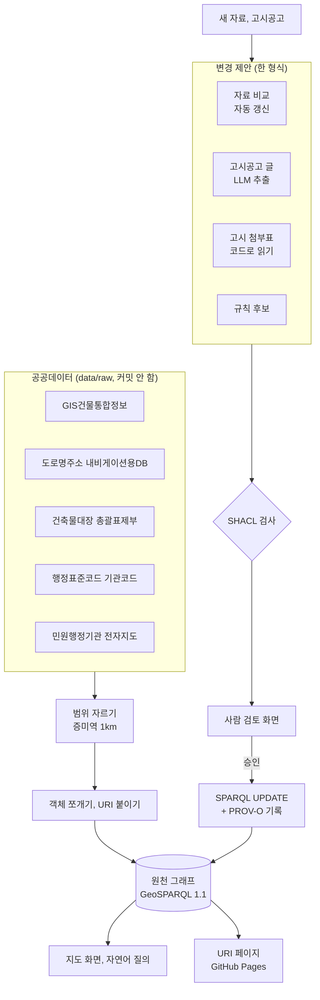

# 증미역 공간 지식 그래프 (Jeungmi GeoKG)

서울 9호선 증미역 반경 1km 안의 건물, 출입구, 필지, 도로, 공공시설, 역, 행정동과 법정동을 "의미 있는 객체"로 쪼개고, 객체마다 나라에서 쓰는 관리번호로 바뀌지 않는 주소(URI)를 붙여 GeoSPARQL 1.1 지식 그래프로 엮은 프로토타입입니다.

국토교통부 "국가기본도 대전환" 방향인 **객체 원자화, 영구 식별자, 자동 갱신, AI 제안 후 사람 승인**을 작은 지역에서 처음부터 끝까지 실제 공공데이터로 돌려 보는 것이 목표입니다.

**URI가 실제로 열립니다:** https://yeodh10.github.io/jeungmi-geokg/ (예: [증미역](https://yeodh10.github.io/jeungmi-geokg/id/station/1150010200106660040000001), [어휘](https://yeodh10.github.io/jeungmi-geokg/def/)). 객체마다 사람이 읽는 페이지와 Turtle(`index.ttl`)이 있습니다.

| 지도 화면 | 변경 제안 검토 화면 |
|---|---|
|  |  |

| 공개 URI 사이트 |
|---|
|  |

## 국가기본도 대전환 방향과 이 프로젝트

| 방향 | 이 프로젝트에서 한 것 | 어디에 |
|---|---|---|
| 객체 원자화 | 원천 자료 8종을 건물, 출입구, 필지, 도로와 도로 구간, 공공시설, 역, 행정동, 법정동, 기초구역 객체로 쪼갰습니다. 출입구는 면한 도로 구간에 이어집니다. 국가기본도 지형지물 분류(수치지도 작성 작업규칙 제9조)를 어휘에 넣고, 국가기본도 건물을 객체ID 그대로 받아 우리 건물과 이었습니다. 모든 객체는 GeoSPARQL Feature이고 모양(Geometry)은 따로 둡니다. | `src/model/`, `src/graph/ontology.ttl` |
| 영구 식별자 | 새 번호를 만들지 않고 건물관리번호, PNU, 도로명코드, 도로구간 일련번호, 법정동코드, 행정동코드, 기초구역번호, 행정표준코드 기관코드를 그대로 URI에 씁니다. 객체가 사라져도 URI는 남기고 상태만 폐지로 바꿉니다. 11,831개 URI를 GitHub Pages에 올려 실제로 열리게 했습니다. | [docs/uri-policy.md](docs/uri-policy.md), `src/graph/publish.py` |
| 자동 갱신 | 새 자료가 오면 그래프를 덮어쓰지 않고 객체마다 비교해 신규, 변경, 폐지, 주소 연결 제안을 만듭니다. | `src/review/diff_proposals.py` |
| AI 제안 후 사람 승인 | 고시공고 글은 LLM이 바뀌는 내용만 뽑고, 객체 찾기는 코드 규칙이 합니다. 국가기본도 건물의 주소로 주소 미연결 건물을 건물관리번호 건물에 잇는 제안도 규칙이 냅니다. 모든 제안은 SHACL 규칙 검사를 거쳐 사람이 승인해야 그래프에 들어가고, 누가 언제 승인했는지 PROV-O로 남습니다. | `src/llm/`, `src/review/`, `src/graph/shapes.ttl` |

실제 사례: 강서구 **도로명주소 폐지 고시(제2026-140호, 2026-10-28)** 의 첨부 폐지조서 12줄 중 범위 안 4곳을 그래프의 건물 5개와 맞춰, 건물과 출입구를 폐지하는 제안 5건을 만들었습니다(위 오른쪽 화면).

## 숫자로 보기 (2026-10-29)

| 항목 | 값 |
|---|---|
| 건물 | 2,790 (건물관리번호로 식별 2,162, 주소 미연결 628) |
| 건물 출입구 | 2,180 (주출입구 2,161, 보조출입구 19) |
| 필지 | 1,760 (PNU, 63곳에 단지 정보) |
| 공공시설 | 23 (행정표준코드 기관코드, 26곳 중 3곳은 사람 검토로) |
| 도로 | 도로 76, 도로 구간 233 (출입구 2,120개가 면한 구간에 이어짐) |
| 행정동, 법정동, 기초구역, 역 | 8, 6, 54, 1 |
| 국가기본도와 연결 | 국가기본도 건물 375(약 600m 영역) 중 109동, 수치지형도 건물 4,093(도엽 37608075) 중 1,685동을 우리 건물과 이음 |
| 트리플 | 167,500여 (어휘 포함) |
| SHACL 검사 | 원천 자료 문제 1건만 남음 (대지면적 0인 필지) |
| URI 페이지 | 11,831쪽 (이용 조건 확인 중인 공공시설, 도로 구간, 국가기본도와 수치지형도 건물 등 4,739개는 보류) |
| 전체 다시 만들기 | `python -m src.pipeline` 한 번, 약 5분 30초 |
| LLM 평가 (실제 모델) | 자연어 질의 25문제 중 23 맞음 (나머지 2개도 정답은 결과에 있음), 실제 강서구 고시 95건 추출에서 근거 문장과 주소를 지어낸 것 0건. [docs/llm-eval.md](docs/llm-eval.md) |
| 테스트 | 9종 (검토, 자동 갱신, 고시공고 LLM, 자연어 질의, SHACL, 폐지조서, 화면 API, 국가기본도 주소 연결, 평가 채점) |

## 구조



- 원천 그래프는 원본에서 언제든 다시 만들 수 있게 두고, 사람이 승인한 변경만 그 위에 승인 순서대로 얹습니다.
- 공간 관계(맞닿음, 포함, 겹침)는 미리 계산하지 않고 SPARQL에서 `geof:sfTouches`, `geof:sfIntersects` 같은 GeoSPARQL 위상 함수로 계산합니다.
- LLM은 바뀌는 내용을 뽑거나 질문을 SPARQL로 바꾸는 데만 쓰고, URI를 정하는 일은 맡기지 않습니다. 영구 식별자를 지어낼 수 없게 하기 위해서입니다.

## 데이터

| 자료 | 제공 | 이용 조건 | 쓰임 |
|---|---|---|---|
| GIS건물통합정보 (서울) | 국토교통부, 브이월드 | 이용허락범위 제한 없음 | 건물 모양, 대장 속성, PNU |
| 도로명주소 내비게이션용DB | 행정안전부 | 이용허락범위 제한 없음 | 건물관리번호, 출입구, 행정동, 역 |
| 건축물대장 총괄표제부 | 서울열린데이터광장 | 공공누리 1유형 | 필지의 단지 정보 |
| 행정표준코드 기관코드 | 행정안전부 | 이용허락범위 제한 없음 | 공공시설 URI |
| 민원행정기관 전자지도 | 행정안전부 | 확인 중 (공개 페이지에서 뺌) | 공공시설 위치 |
| 도로명주소 전자지도 (서울) | 행정안전부 | 확인 중 (도로 구간과 경계 모양은 공개 페이지에서 뺌) | 도로 구간, 법정동과 기초구역 경계 |
| 국가기본도, 수치지형도 Ver2.0 | 국토지리정보원 | 확인 중 (공개 페이지에서 뺌) | 국가기본도 건물과 우리 건물 잇기, 층수와 주소 견주기 |
| 강서구청 고시공고 | 강서구청 | 저작권법 제7조 (고시, 공고) | 변경 제안의 근거 |

서울, 전국으로 키울 때의 설계와 근거(저장소 크기, 질의 시간 측정)는 [docs/scale-design.md](docs/scale-design.md)에 있습니다.

원본은 저장소에 올리지 않습니다. 받는 방법, 좌표계 확인, 이용 조건 근거는 [docs/data-sources.md](docs/data-sources.md)에 있습니다. 범위 중심은 내비게이션용DB의 증미역 역사 건물 중심점(경도 126.861247, 위도 37.557719)이고 출처는 [config/area.yaml](config/area.yaml)에 있습니다.

## 실행

명령은 프로젝트 폴더에서 Git Bash 기준입니다. Windows PowerShell에서는 `.venv/Scripts/python`을 `.\.venv\Scripts\python.exe`로 바꿔 씁니다.

```bash
python -m venv .venv
.venv/Scripts/python -m pip install -r requirements.txt
cp .env.example .env                                   # ANTHROPIC_API_KEY 등 키 값
```

원본 압축 파일을 `data/raw/_archives/`에 넣고 전체를 다시 만듭니다 (7-Zip이 없으면 `pip install py7zr`).

```bash
.venv/Scripts/python -m src.pipeline --unpack
```

범위 자르기, 객체와 URI, 그래프, 예시 쿼리(`data/processed/query_check.md`), SHACL 검사(`validation_report.md`), URI 페이지(`site/`)가 차례로 만들어집니다.

화면:

```bash
.venv/Scripts/python -m uvicorn src.review.app:app --port 8000
```

http://localhost:8000 은 변경 제안 검토, http://localhost:8000/map 은 지도와 자연어 질의입니다.

URI 페이지 다시 올리기 (`gh-pages` 브랜치에 `data/processed/site/`를 통째로 올리면 GitHub Pages가 알아서 다시 만듭니다):

```bash
git worktree add ../jeungmi-geokg-pages gh-pages
cp -r data/processed/site/. ../jeungmi-geokg-pages/ && rm ../jeungmi-geokg-pages/publish_report.json
cd ../jeungmi-geokg-pages && git add -A && git commit -m "URI 공개 페이지 다시 만듦" && git push && cd -
git worktree remove ../jeungmi-geokg-pages
```

제안 만들기:

```bash
.venv/Scripts/python -m src.review.address_retirement data/raw/notices/attachments/20261028_폐지조서.xlsx --notice data/raw/notices/20261028_도로명주소_폐지_고시.txt
.venv/Scripts/python -m src.llm.notice data/raw/notices/<고시공고>.txt          # Claude API 키 필요
.venv/Scripts/python -m src.review.diff_proposals --raw <새 원본 폴더> --label 202610
.venv/Scripts/python -m src.review.make_proposals                               # 공공시설 기관코드 후보
.venv/Scripts/python -m src.review.basemap_proposals                            # 국가기본도 주소로 주소 미연결 건물 잇기
```

테스트 (LLM 부분은 가짜 클라이언트로 돌아서 키가 없어도 됩니다. 제안 기록은 임시 복사본만 씁니다):

```bash
for t in test_review test_diff test_notice test_nl test_shacl test_address_retirement test_api; do .venv/Scripts/python -m tests.$t; done
```

## 주요 기능

### 변경 제안과 사람 승인

- 제안은 출처(`rule-candidate`, `data-diff`, `llm-notice`, `notice-table`)와 상관없이 같은 형식입니다. 대상 URI, 근거, 넣고 뺄 트리플, 위치를 담습니다.
- 검토 화면은 바뀌는 내용을 객체별로 "지금 → 바뀐 뒤"로 보여 주고, 반영 결과를 SHACL로 미리 검사해 규칙을 어기면 승인을 막습니다.
- 승인하면 바뀐 객체가 `prov:wasInfluencedBy`로 제안을 가리키고, 제안에는 승인한 사람과 시각이 남습니다. 반려한 제안도 기록에 남습니다.
- 검토 화면: 같은 고시에서 나온 제안을 묶어 보여 주고(예: "서울특별시 강서구 고시 제2026-140호, 이 고시 5건"), 검색, 종류와 출처 거르기, 정렬, 결정 이력(누가, 언제, 사유)을 볼 수 있습니다. 반려에는 사유가 꼭 있어야 하고, 단축키(j, k 이동, a 승인, r 반려, / 검색, ? 안내)로 빠르게 처리합니다.
- 묶어 결정: 같은 고시의 대기 제안을 제안 순서대로, 앞 제안을 반영한 그래프에서 다음 제안을 SHACL로 검사합니다. 승인은 통과한 제안만 한 번에 하고, 어긴 제안은 대기로 남깁니다. 같은 건물을 두 제안이 서로 다르게 바꾸는 경우처럼 하나씩 볼 때는 보이지 않는 충돌을 잡습니다.
- 결정 정정: 승인이나 반려가 틀렸으면 지우지 않고 정정합니다. 대기로 되돌리기, 승인을 반려로, 반려를 승인으로 바꿀 수 있고 사유가 꼭 있어야 합니다. 앞의 결정은 정정 이력에 그대로 남습니다. 승인을 거두면 원천 그래프와 남은 승인 기록으로 그래프를 다시 만들고, 뒤에 승인된 제안이 같은 객체를 바꿨으면 그쪽부터 정정하게 막습니다.
- 서버를 켜면 그래프를 뒤에서 미리 불러 둡니다(`/api/status`로 확인). 자연어 질의의 SPARQL은 20초 안에 끝나야 하고, 넘기면 504로 답하고 그 쿼리가 끝날 때까지 새 질의를 받지 않습니다.
- 지도 화면에 도로 구간(전자지도 도로구간)과 법정동 경계를 켜고 끌 수 있습니다. 도로 구간을 누르면 그 구간에 면한 출입구가 보입니다.
- 지도 화면: 자료 범위(1km 원), 건물 상태별 거르기와 개수, 행정동별 강조, 공백을 무시한 찾기, 객체마다 공개 URI 페이지와 Turtle 링크, 반영된 변경 제안 이력을 보여 줍니다. 확대 위치와 고른 객체가 주소창에 남아 그대로 공유할 수 있습니다.
- API는 URI 입력을 검사해 SPARQL 주입을 막고, 제안 파일 쓰기를 잠가 동시 결정이 섞이지 않게 하며, 지도 레이어를 gzip과 ETag로 보냅니다.

### 자동 갱신

| 제안 | 언제 | 승인하면 |
|---|---|---|
| create | 새 자료에만 있는 객체 | 객체와 모양을 추가 |
| update | 값이 달라진 객체 | 이전 값을 빼고 새 값을 넣음 |
| retire | 새 자료에서 사라진 객체 | 지우지 않고 상태를 폐지로, 폐지 확인일 기록 (URI 유지) |
| link | 주소 미연결 건물이 새 건물관리번호 건물의 모양으로 쓰임 | 상태를 주소 연결됨으로, `owl:sameAs`로 새 URI와 연결 |

### 고시공고에서 제안 만들기

- 글로 된 본문은 LLM(`claude-opus-5-5`, 구조화 출력)이 변경 종류, 대상의 주소나 이름, 새 값, 원문 문장을 뽑습니다. 안전 분류기가 거절하면 서버가 다른 모델로 다시 돌립니다(`fallbacks: "default"`).
- 첨부가 표(엑셀)면 LLM 없이 코드가 읽습니다.
- 객체 찾기는 코드가 이름, 도로명주소, 지번 순서로 합니다. 정확히 하나로 찾은 것만 제안이 되고, 후보가 여럿이면 보고서에만 남습니다.

### 자연어 질의

- LLM이 어휘, 그래프의 주요 이름과 값, 예시 쿼리(`src/graph/queries/`)를 보고 SPARQL을 씁니다.
- 실행 전에 코드가 읽기 쿼리(SELECT, ASK)만 통과시키고 500행으로 제한합니다. 실패하면 오류를 붙여 한 번 더 쓰게 합니다.
- pyoxigraph에 거리 함수가 없어서, "역에서 300m 안" 같은 조건은 LLM이 `{{NEAR:<URI>:<미터>}}`를 쓰면 코드가 원 모양(EPSG:5186에서 계산)으로 바꿉니다.

### 데이터 규칙 (SHACL)

`src/graph/shapes.ttl`: 상태 값, 출처, 기본 모양, 건물 식별 번호(건물관리번호 25자리와 GIS 번호 28자리 중 정확히 하나), PNU 형식, 기관코드 7자리, 폐지하면 폐지 확인일, 출입구는 건물과 이어질 것 등. 첫 검사에서 필지 1,697개에 출처가 빠진 것을 찾아 고쳤습니다.

## 기술 스택

Python 3.12, geopandas, shapely, pyproj, pyogrio, rdflib, pyoxigraph (SPARQL, GeoSPARQL 위상 함수), pyshacl, Claude API, FastAPI, MapLibre GL JS, OpenStreetMap 배경지도. 저장 좌표계는 EPSG:4326, 거리 계산은 EPSG:5186입니다. 기본값에서 바꾸거나 새로 정한 것은 [docs/decisions.md](docs/decisions.md)에 날짜와 이유를 적었습니다.

## 폴더 구조

```
config/          대상 범위, 역, 공개 보류 출처
data/raw/        원본 데이터 (커밋 안 함)
data/processed/  잘라낸 자료, 객체, 그래프, 검사 결과, 제안 기록 (커밋 안 함)
src/ingest/      압축 풀기, 범위 자르기
src/model/       객체 쪼개기, URI
src/graph/       어휘, 그래프, 예시 쿼리, SHACL, URI 페이지
src/llm/         Claude API 호출, 고시공고 추출
src/review/      변경 제안, 자동 갱신 비교, 폐지조서, 검토 API
src/query/       자연어 질의
web/             검토 화면, 지도 화면
tests/           흐름 테스트
docs/            데이터 출처, URI 규칙, 결정 기록, 시연 순서
```

## 진행 상황과 남은 일

| 기간 | 할 일 | 상태 |
|---|---|---|
| 10/28 ~ 11/3 | 데이터 받기, 범위 자르기, 이용 조건 기록 | 전자지도만 승인 대기 |
| 11/4 ~ 11/10 | 객체 쪼개기, URI, 그래프, SPARQL | 끝 (10/29) |
| 11/11 ~ 11/17 | LLM 변경 제안, 자연어 질의 | 끝 (가짜 클라이언트로 확인, 실제 키로 돌리기 남음) |
| 11/18 ~ 11/24 | 검토 화면, 지도 화면, 배포, README와 시연 영상 | 화면, README, 배포 끝, 영상 남음 |

남은 일:

- [x] 실제 Claude API 키로 고시공고(등촌1구역 관리처분계획 변경인가)와 자연어 질의 돌려 보기 (고시는 구체적 변경이 없어 제안 0건, 질의 3개 맞음)
- [x] LLM 평가 세트: 자연어 질의 25문제(정답 SPARQL), 실제 강서구 고시 95건(정답 23건) ([docs/llm-eval.md](docs/llm-eval.md))
- [x] 고시의 변경 종류 넓히기: 구역 지정, 해제, 사업 인가, 준공을 더해 other가 90%에서 2%로. 고시를 객체(notice/{시군구코드}-{연도}-{번호})로 두고 대상 필지, 건물에서 잇는 제안
- [x] GitHub Pages로 URI 페이지 배포 (10/29, `gh-pages` 브랜치, 공공시설 23곳은 이용 조건 확인 전까지 제외)
- [x] 도로명주소 전자지도로 도로 구간, 출입구의 `facesRoad`, 법정동과 기초구역 넣기 (행정동 경계는 전자지도에 없음. 주소 미연결 건물 628개는 PNU로 법정동에 이음)
- [x] 국가기본도 지형지물 분류(수치지도 작성 작업규칙 제9조)를 어휘에 넣고, 국가기본도와 수치지형도 건물을 공식 번호(nf_id, UFID)로 넣어 우리 건물과 잇기
- [x] 국가기본도 주소로 주소 미연결 건물 잇기 제안 (5건, 검토 대기)
- [ ] 국가기본도를 반경 1km 전체로 받기 (지금은 약 600m), 수치지형도 37608085 도엽 받기
- [ ] 전자지도 건물 폴리곤으로 점만 있는 건물 324개에 모양 붙이기, 주소 미연결 건물 628개를 겹침으로 건물관리번호에 잇는 제안 만들기 (전자지도 이용 조건 확인 뒤)
- [ ] 민원행정기관, 전자지도 이용 조건 확인
- [ ] 새 기준일 자료(내비게이션용DB 10월분 등)로 자동 갱신 실제로 돌려 보기
- [ ] 필지 경계(연속지적도) 붙이기
- [ ] 시연 영상 ([docs/demo.md](docs/demo.md) 순서대로)
- [x] 같은 고시 제안 묶어 승인 (SHACL 통과한 것만, 앞 제안을 반영한 상태로 다음 제안을 검사)
- [x] 결정 정정 기록 (반려 기록은 지우지 않는 설계와 맞춰 "정정"을 새 기록으로 남기기)
- [x] 서버 시작 때 그래프 미리 불러오기, 자연어 질의 쿼리 시간 제한

다른 컴퓨터에서 이어 할 때는 `git clone`, 가상환경 만들기, 원본 압축 파일 6개(`data/raw/_archives/`, 약 590MB)와 고시공고 폴더(`data/raw/notices/`)를 같은 자리에 두고 `python -m src.pipeline --unpack`을 실행하면 됩니다.
