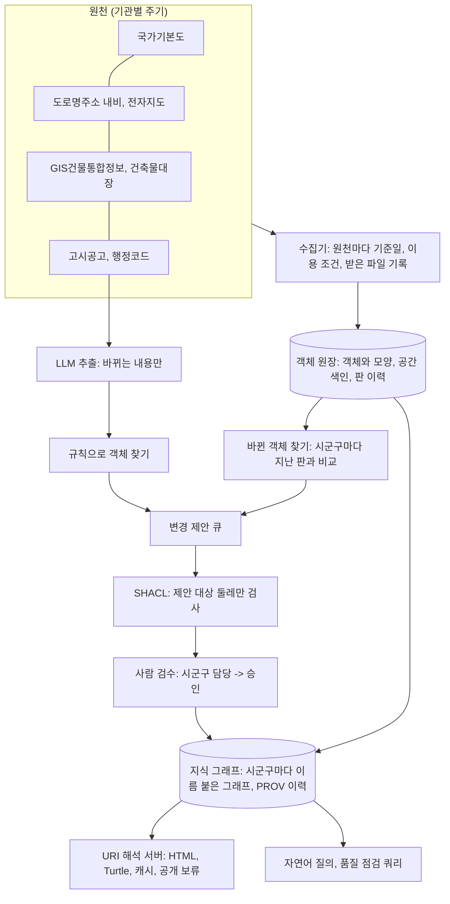

# 전국 규모 설계

증미역 반경 1km에서 돌린 구조를 서울, 전국으로 키울 때 무엇을 그대로 두고 무엇을 바꿔야 하는지 정리한다.
숫자는 모두 이 저장소에서 잰 값이거나, 잰 값에 원본에서 센 개수를 곱한 계산이다. 계산한 값은 "계산"이라고 적는다.

## 1. 지금 잰 값

### 프로토타입 (증미역 반경 1km, 2026-10-29)

| 항목 | 값 | 출처 |
|---|---|---|
| 객체 | 11,599 (건물 2,790, 출입구 2,180, 필지 1,760, 수치지형도 건물 4,093, 국가기본도 건물 375 등) | `objects_report.json` |
| 트리플 | 167,547 (객체 하나에 평균 14.4) | `jeungmi_geokg.ttl` |
| 건물 하나의 트리플 | 약 22 (자기 트리플 19 + 모양 노드 3) | 그래프에서 셈 |
| 출입구 하나의 트리플 | 약 12 | 그래프에서 셈 |
| 전체 다시 만들기 | 335초 (그래프 만들기 115, SHACL 전체 검사 119, 공개 페이지 65) | `pipeline_report.json` |
| 제안 하나 검사 (SHACL, 대상 둘레만) | 약 0.2초 | 2026-10-29 측정 |
| 공개 페이지 | 11,831쪽, 88MB | `site/` |

### 저장소가 커질 때 (`python -m src.graph.bench_scale`)

지금 그래프를 1벌, 5벌, 20벌 복사해 pyoxigraph 디스크 저장소에 넣고 잰 값이다. 모양은 같은 자리에 겹쳐 놓았다.

| 복사 | 트리플 | 불러오기 | 저장소 크기 | URI 하나 찾기 | 속성 값으로 찾기 | 모양으로 찾기 (약 200m 사각형) |
|---|---|---|---|---|---|---|
| 1 | 167,547 | 3.3초 | 15MB | 0.5ms | 0.1ms | 87ms |
| 5 | 837,735 | 14.8초 | 66MB | 0.4ms | 0.2ms | 547ms |
| 20 | 3,350,940 | 55.7초 | 469MB | 0.3ms | 0.2ms | 4,648ms |

- 불러오기는 트리플 수에 비례한다(초당 약 6만 트리플).
- 번호로 찾기(URI, 건물관리번호)는 커져도 그대로다. 저장소가 주어, 술어, 목적어마다 색인을 가지고 있어서다.
- 모양으로 찾기는 데이터에 비례해 느려진다(20배에서 53배). pyoxigraph에는 공간 색인이 없어 모든 모양을 하나씩 견주기 때문이다.

### 원본에서 센 개수

| 자료 | 서울 | 전국 |
|---|---|---|
| 내비게이션용DB 건물 (2026년 9월분) | 592,871 | 10,717,936 |
| GIS건물통합정보 건물 | 695,753 | 세지 않음 (서울분만 받음) |
| 도로명주소 전자지도 건물, 출입구, 도로구간 | 591,225, 523,485, 66,683 | 세지 않음 (서울분만 받음) |

## 2. 그대로 커지는 것과 막히는 것 (계산)

잰 값에 개수를 곱한 계산이다. 실제로는 시범 지역에서 다시 재서 고친다.

| 항목 | 서울 (계산) | 전국 건물만 (계산) | 판단 |
|---|---|---|---|
| 트리플 | 건물 69.6만 × 22 + 출입구 52.3만 × 12 + 도로구간 6.7만 × 15 ≈ 2,260만 | 건물 1,072만 × 22 ≈ 2.4억 | 저장은 된다 |
| 저장소 크기 (트리플당 약 140바이트, 20벌 측정값) | 약 3GB | 약 33GB | 디스크로 충분하다 |
| 불러오기 (초당 6만) | 약 6분 | 약 66분 | 밤사이 다시 불러오기 가능 |
| 모양으로 찾기 (20벌 건물 5.6만 동에 4.6초, 건물 수에 비례) | 약 1분 (건물 69.6만) | 약 15분 (건물 1,072만) | **막힌다. 공간 색인이 꼭 있어야 한다** |
| 그래프 만들기 (rdflib, 초당 약 1,500 트리플) | 4시간 넘음 | 하루 넘음 | **막힌다. 쓰는 방식을 바꾼다** |
| SHACL 전체 검사 (pyshacl, 16.7만에 119초) | 4시간 넘음 | 불가 | **막힌다. 바뀐 객체만 검사한다** |
| 공개 정적 페이지 (11,831쪽에 65초, 88MB) | 건물과 출입구만 약 122만 쪽, 약 2시간, 약 9GB | 불가 | **막힌다. 요청 때 만드는 서버로** |

결론: 저장과 번호로 찾기는 지금 방식 그대로 전국까지 간다. 막히는 곳은 네 군데(공간 질의, 그래프 만들기, 전체 검사, 정적 공개)이고, 모두 "전체를 매번 다시"가 원인이다. 전국에서는 **바뀐 것만, 지역을 나눠서** 처리하는 구조로 바꾼다.

## 3. 구조

### 3-1. 객체 원장과 지식 그래프를 나눈다

- **객체 원장**: 객체, 모양, 공간 색인, 판(버전) 이력을 둔다. 모양으로 거르는 일(반경 안, 겹침, 포함)은 여기서 한다. 지금 프로토타입이 geopandas로 하던 일(범위 자르기, 모양 맞추기, 출입구와 도로 구간 잇기)이 이쪽으로 간다.
- **지식 그래프**: 관계, 분류, 출처, 결정 이력(PROV)을 둔다. 모양은 WKT로 함께 두되, 공간 조건이 들어간 질의는 공간 색인이 있는 쪽에서 먼저 거른다.
- 공간 색인을 어디에 둘지는 두 안을 시범 지역에서 같은 쿼리(쿼리 04, 05, 11과 위 표의 모양으로 찾기)로 재서 고른다.
  - 안 1: 공간 색인을 갖춘 GeoSPARQL 저장소 (예: Apache Jena GeoSPARQL의 공간 색인)
  - 안 2: 공간 데이터베이스(PostGIS)로 후보 URI를 먼저 거르고, 그 URI로 그래프를 묻는다. 지금 자연어 질의가 `{{NEAR:URI:미터}}` 자리표시를 코드가 원으로 바꾸는 것과 같은 나눔이다.

### 3-2. 지역으로 나눈다

- 시군구마다 이름 붙은 그래프(named graph) 하나를 둔다. 건물관리번호와 PNU의 앞 5자리가 시군구코드라서 번호만 보고 어느 그래프인지 정할 수 있다.
- 다시 불러오기, SHACL 검사, 바뀐 객체 찾기를 시군구마다 따로, 동시에 한다.
- 시군구 경계에 걸친 객체(도로 구간 등)는 그 객체 번호의 시군구에 둔다. 도로 구간 URI가 이미 `{시군구코드}-{일련번호}`라서 그대로 맞다.

### 3-3. 바뀐 것만 처리한다

- 그래프 만들기: rdflib로 전체를 Turtle로 쓰는 대신, 바뀐 객체의 트리플만 N-Triples로 흘려 저장소에 바로 넣는다(pyoxigraph `bulk_extend`는 위 측정에서 초당 6만).
- SHACL: 지금 승인 전 검사처럼 바뀐 객체와 그 둘레(이어진 객체의 종류)만 떼어 검사한다. 제안 하나에 약 0.2초라서, 시군구 하루 변경이 수백 건이어도 몇 분이다(계산).
- 공개: 정적 페이지를 미리 다 만들지 않고, URI를 요청받으면 그래프에서 만들어 캐시한다. 결정이 나면 그 객체의 캐시만 지운다. 지금 지도 레이어에 쓰는 판 번호와 ETag 방식을 그대로 쓴다.

### 3-4. 식별자

- 새 번호를 만들지 않고 공식 번호를 그대로 쓰는 원칙(`docs/uri-policy.md`)은 전국에서도 같다.
- 다만 공식 번호끼리 어긋나는 곳이 실제로 있다. 전국 운영에서는 번호 대응표(같은 객체를 가리키는 번호들)를 따로 관리하고, 대응마다 출처와 근거를 남긴다.
  - GIS건물통합정보 A21과 국가기본도 국토부 UFID는 꼴은 같지만 값이 하나도 같지 않다(영역 안 215개 중 0).
  - GIS 건물 번호(A1)가 서울에서 405개 겹친다.
  - 주소의 법정동과 모양이 놓인 법정동이 다른 건물이 있다(반경 안 2동).
- 대응은 모양 맞추기(IoU)로 후보를 내고, PNU와 도로명주소로 한 번 더 확인한다. 지금 국가기본도 109쌍 중 PNU 99쌍, 주소 89쌍이 같았다. 확인되지 않는 대응은 제안으로 보내 사람이 정한다(국가기본도 주소 연결 제안 5건과 같은 흐름).

## 4. 갱신과 검수

| 원천 | 지금 받은 판 | 갱신 방식 |
|---|---|---|
| 내비게이션용DB | 2026년 9월분 | 월마다 전체분. 지난 판과 객체마다 비교해 제안 (`diff_proposals.py`) |
| 도로명주소 전자지도 | 2026년 9월분 | 월마다. 도로 구간, 경계를 같은 방식으로 비교 |
| GIS건물통합정보 | 기준일 2026-10-06 (A22) | 받는 주기마다 비교 |
| 국가기본도 | 2026-10-29 내려받기 | 객체마다 날짜 필드(obchg_dt 등)가 있어, 바뀐 객체만 받을 수 있는지 확인이 필요하다 |
| 고시공고 | 강서구청 2건 | 글은 LLM이 바뀌는 내용만 뽑고, 첨부표는 코드가 읽는다 |

- 검수 흐름: 제안은 시군구 담당자가 먼저 보고, 묶음(같은 고시, 같은 규칙)으로 결정한다. 승인은 SHACL을 통과한 것만 된다. 틀린 결정은 지우지 않고 정정 기록으로 남긴다. 이 흐름은 프로토타입 검토 화면에 이미 있다.
- 실제 사례 처리량: 도로명주소 폐지 고시 하나(폐지조서 12줄)에서 범위 안 제안 5건, 국가기본도 주소 규칙에서 5건이 나왔다. 전국에서는 시군구마다 하루 제안 수, 승인까지 걸린 시간, 반려 비율을 재서 규칙의 기준값(IoU, 거리)을 고친다.

## 5. 품질 지표

지금 예시 쿼리를 그대로 시군구마다 돌려 지표로 쓴다.

| 지표 | 반경 1km 값 | 쿼리 |
|---|---|---|
| 주소 미연결 건물 비율 | 628 / 2,790 (22.5%) | 02 |
| 출입구가 도로 구간에 이어진 비율 | 2,120 / 2,180 | 10과 `review_entrance_road.csv` |
| 번호로 정한 법정동과 모양이 맞는 비율 | 2,788 / 2,790 | 11 |
| 국가기본도와 이어진 건물, PNU와 주소 일치 | 109동, PNU 99, 주소 89 / 92 | 12 |
| 건축물대장과 지도의 층수가 다른 건물 | 393 / 1,685 (수치지형도) | 13 |
| SHACL 위반 | 1건 (원천 대지면적 0) | `validation_report.md` |

## 6. 단계

| 단계 | 범위 | 끝났다고 볼 기준 |
|---|---|---|
| 1 | 시범 시군구 1곳 (강서구) | 공간 색인 두 안을 재서 고름. 한 달치 원천 갱신을 제안, 검수, 반영까지 한 번 돌림 |
| 2 | 서울 | 시군구 25개를 동시에 처리. 하루 변경을 그날 안에 반영. 위 품질 지표를 시군구마다 매일 냄 |
| 3 | 전국 | 같은 구조를 시도마다 늘림. 번호 대응표와 이용 조건 관리를 운영 절차로 만듦 |

## 7. 열린 문제

- 이용 조건: 민원행정기관 전자지도, 도로명주소 전자지도, 수치지형도, 국가기본도의 공개 범위를 확인해야 한다. 지금은 공개 페이지에서 뺀다.
- 코드 정의서: 국가기본도 건물 구분, 용도 코드(BDC…, BDU…)와 수치지형도 세분류 코드의 공식 뜻을 아직 확인하지 못했다.
- 행정동 경계: 도로명주소 전자지도에는 없고 국가기본도 내려받기에는 읍면동(법정동) 경계만 있다. 행정동 경계의 출처를 정해야 한다.
- 번호 체계: GIS건물통합정보 A21과 국가기본도 국토부 UFID의 관계를 제공 기관에 확인해야 한다.
- 위 계산은 모두 선형으로 늘린 값이다. 1단계에서 실제 시군구 하나로 다시 재서 이 문서를 고친다.
